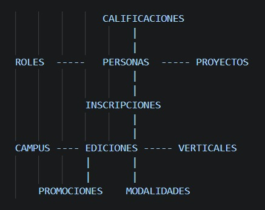
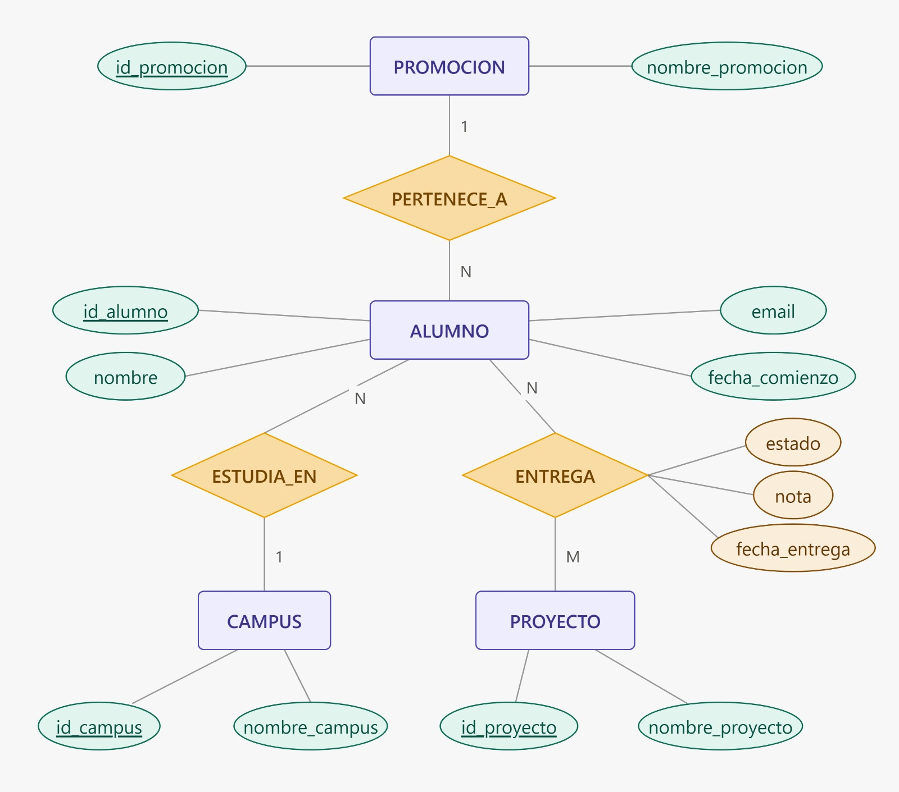
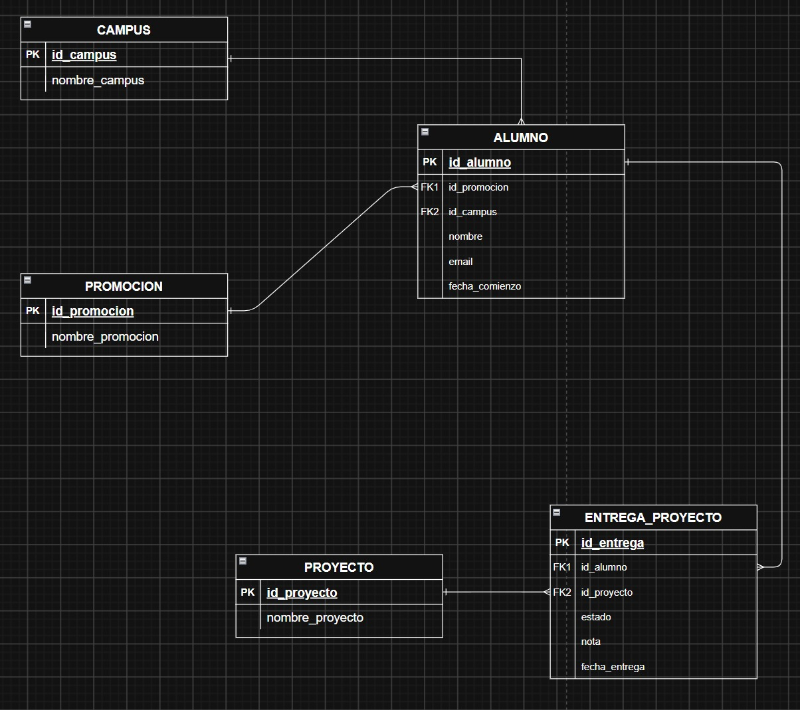
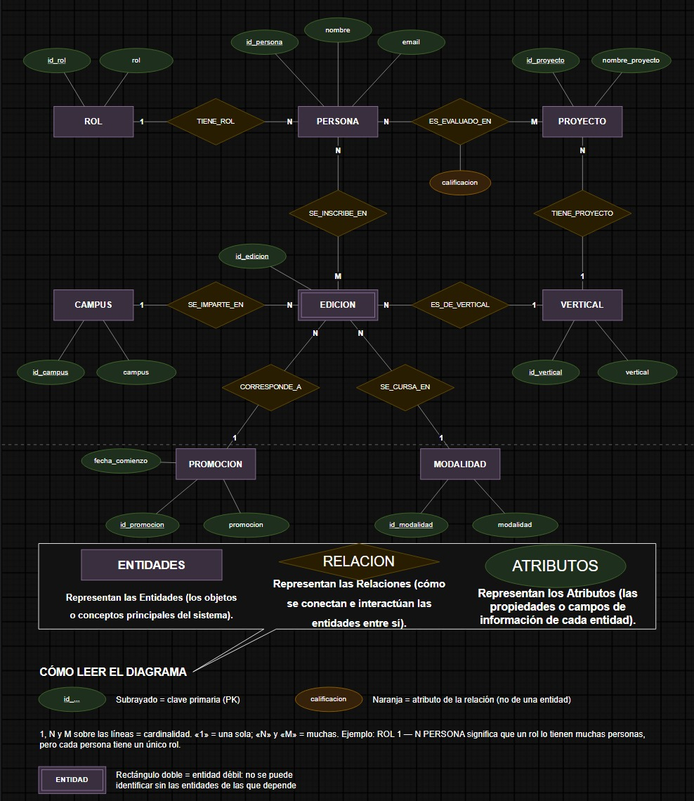
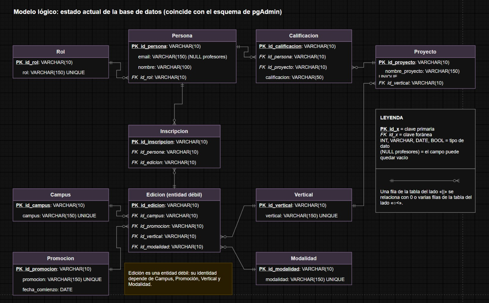
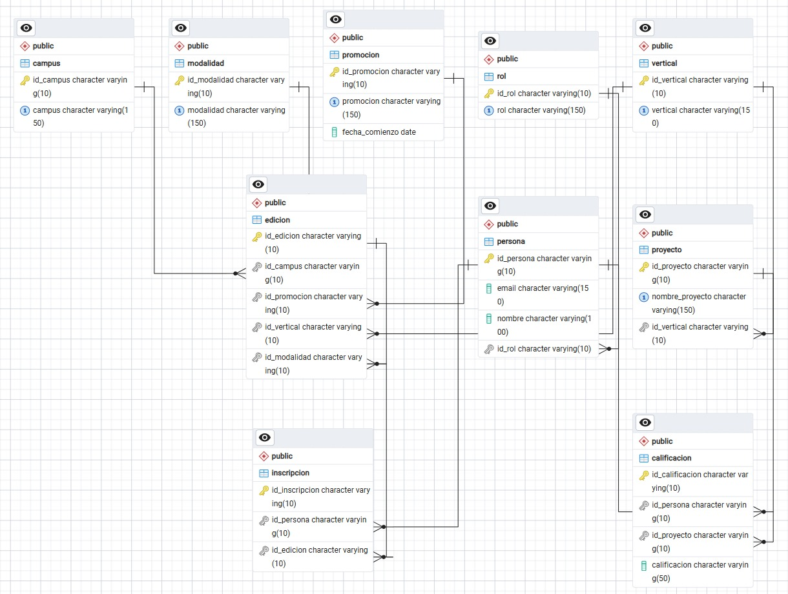

<h1 align="center">🗄️ Base de datos del bootcamp</h1>

  De datos sin normalizar a un modelo relacional de 10 tablas en <b>PostgreSQL</b> 
  
  
  
  

---

## 📌 El proyecto

Partimos de datos sin normalizar: **52 alumnos** de 4 clases (Data Science y Full Stack) y **10 profesores**. El objetivo es una base de datos relacional que pueda **crecer** en campus, verticales, promociones y modalidades sin repetir datos.

| Fase | Qué se hizo |
|---|---|
| 1 | Diagrama Entidad-Relación |
| 2 | Modelo lógico |
| 3 | Normalización (1FN, 2FN y 3FN) |
| 4 | Creación y carga de la base de datos con Docker, pgAdmin 4 y Render |

## 🧭 Cómo fue el proceso

No surgió todo de golpe: empezamos con un boceto, seguimos con un primer E-R y un primer modelo lógico, y los fuimos corrigiendo.

<table align="center">
  <tr>
    <td align="center" width="33%"> <b>1. Boceto</b></td>
    <td align="center" width="33%"> <b>2. Primer E-R</b></td>
    <td align="center" width="33%"> <b>3. Primer modelo lógico</b></td>
  </tr>
</table>

## 🔷 Diagrama Entidad-Relación

8 entidades: Rol, Persona, Proyecto, Edición, Campus, Vertical, Promoción y Modalidad.

- La **calificación** es un atributo de la relación entre persona y proyecto (en naranja).
- **Edición** es una entidad débil (rectángulo doble): no tiene sentido sin su campus, promoción, vertical y modalidad.

## 🧱 Modelo lógico

10 tablas, cada una con su clave primaria (PK) y sus claves foráneas (FK). Todas las claves son `VARCHAR(10)`.

## ✅ Normalización

| Forma normal | Regla | Qué hicimos |
|---|---|---|
| **1FN** | Una celda, un dato | Las 5 columnas `Proyecto_*` pasan a ser filas de `Calificacion` |
| **2FN** | Cada dato depende de la clave completa | Cada dato está en la tabla de lo que describe, con claves de una sola columna (`id_*`) |
| **3FN** | Ningún dato depende de otro que no sea la clave | `fecha_comienzo` depende de la promoción, no del alumno: está solo en `Promocion` |

Más detalle en `Normalizacion_con_modelos_ER_y_logico.pdf`.

## 🛠️ Herramientas

| Herramienta | Para qué |
|---|---|
| **Docker** | Ejecutar PostgreSQL en un contenedor |
| **pgAdmin 4** | Visualizar la base de datos, sus tablas y relaciones |
| **Render** | Simular que la base de datos está en la nube |

Esquema real generado por pgAdmin 4 (coincide con el modelo lógico):

## 📁 Archivos

| Archivo | Qué es |
|---|---|
| `ER_model_chen.drawio` | Diagrama E-R (Chen) y modelo lógico |
| `Normalizacion_con_modelos_ER_y_logico.pdf` | Justificación de la normalización |
| `trabajo.sql` | Creación de tablas y carga de datos |
| `inserts/` | Inserts de cada tabla |
| `trabajo.ipynb` | Cuaderno de trabajo |

## ▶️ Cómo reproducirlo

1. Levanta PostgreSQL (por ejemplo con Docker) y conéctate con pgAdmin 4.
2. Copia los CSV de datos en la ruta que usa `trabajo.sql` (`/tmp/`, dentro del contenedor).
3. Ejecuta `trabajo.sql`: crea las tablas y carga los datos.

> **Nota:** si se ejecuta dos veces, conviene borrar antes las tablas para no duplicar filas.

---

Equipo del proyecto SQL: Julián, Erick, Jaime, Catalin, Dan, David · The Bridge

